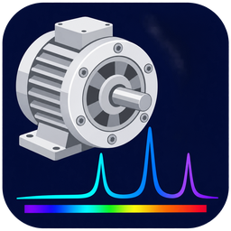
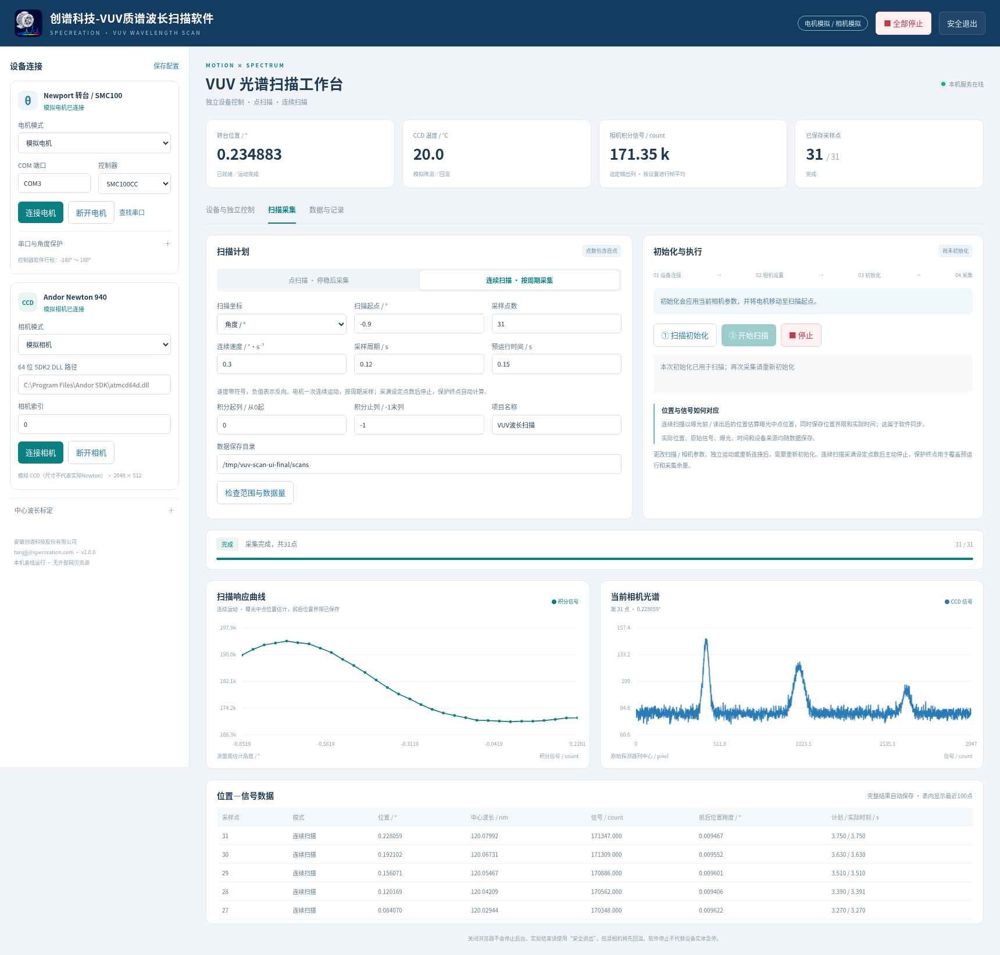

# 创谱科技-VUV质谱波长扫描软件 2.0.0

**[点击下载 Windows 64 位单文件 EXE](https://github.com/TANGJJ0909/TANG09-ChatGPT-DATA/raw/refs/heads/releases/vuv-scan-2.0.0/downloads/vuv-scan/v2.0.0/Specreation_VUV_Scan.exe)**

适用 Windows 10 / 11 x64。文件 31,102,976 字节，约 29.7 MiB。下载后双击运行，首次自动准备内置运行环境，无需安装 Python。界面在本机默认浏览器打开，可离线使用。

## 功能

- 电机、相机分别连接和断开，支持仅连接其中一台设备。
- 电机独立绝对定位、正反向相对运动、速度设置、归零和停止。
- Newton SDK2 曝光、平均帧数、读取模式、ROI / bin、读出速度、增益、快门和制冷设置；支持独立采集及 CSV 导出。
- 独立扫描初始化：校验参数和范围，配置相机，定位并停稳起点；参数或位置变更后重新初始化。
- 点扫描：设置步长和点数，每点停稳后读取位置及相机信号。
- 连续扫描：设置速度、采样周期和点数；一次连续运动，按周期采集，采满后停止。
- 自动保存位置—信号 CSV、完整平均光谱及原始 int32 帧。
- 电机与光谱曲线图标已嵌入 EXE 与界面。

连续扫描保存曝光前 / 读出后的位置、曝光中点的线性估计位置和实际采样时间。**这属于软件同步，不能视为编码器锁存或硬件触发同步。** 未有真实角度—波长标定时使用角度扫描；波长坐标需导入经验证的标定数据。

## 运行与验证

默认设备不连接，模式为模拟，分别点击连接即可试用。真实连接需要厂家电机 / 串口驱动、相机驱动和 Windows x64 Andor SDK2；本包不含厂家专有 SDK DLL。

已通过 **62 项自动化测试**、Chromium 完整界面流程、单文件封装校验及展开后模拟运行。Windows EXE 为交叉编译结果，**尚未在 Windows 实机和实际转台 / Newton 940 上联机验证**。

实验结束请使用“安全退出”，低温相机先回温后断开；保持供电与连接。软件停止不代替实体急停。

- [完整使用说明](使用说明.md)
- [功能与验证记录](功能与验证记录.md)
- [文件校验值](SHA256SUMS.txt)

SHA256：`a2e037221177e20bcdfa256ec945634afb19f8b21bbe31a5261919f6dbf5be19`

